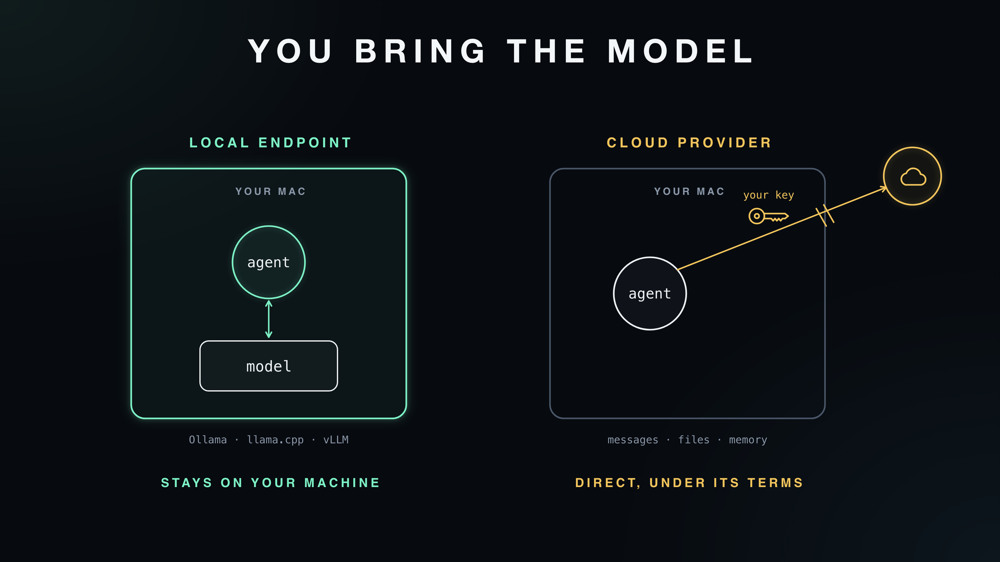
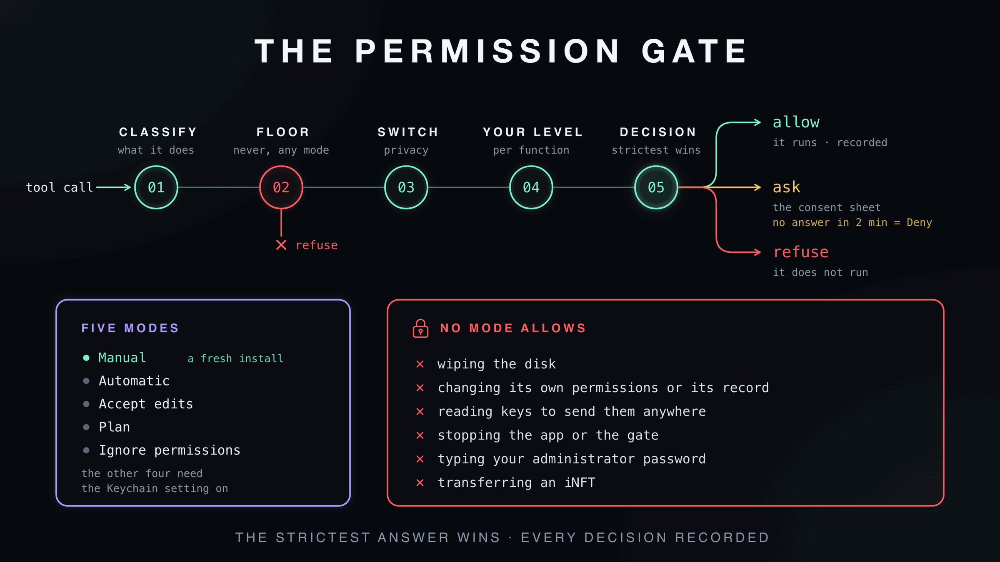
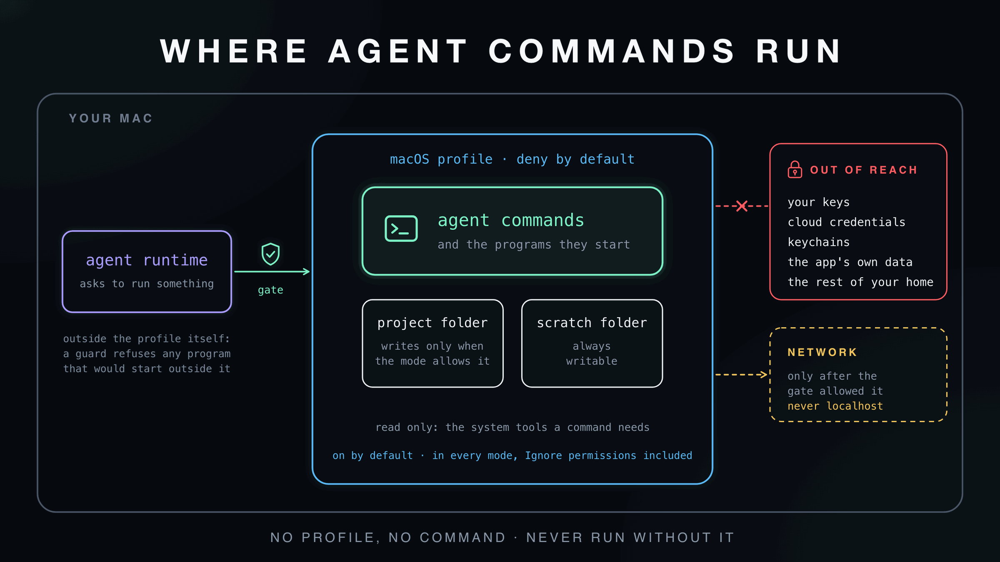
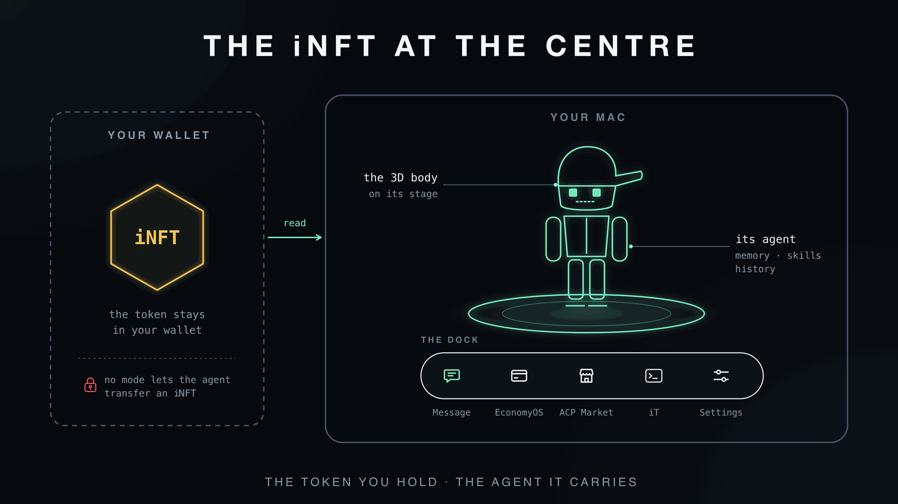
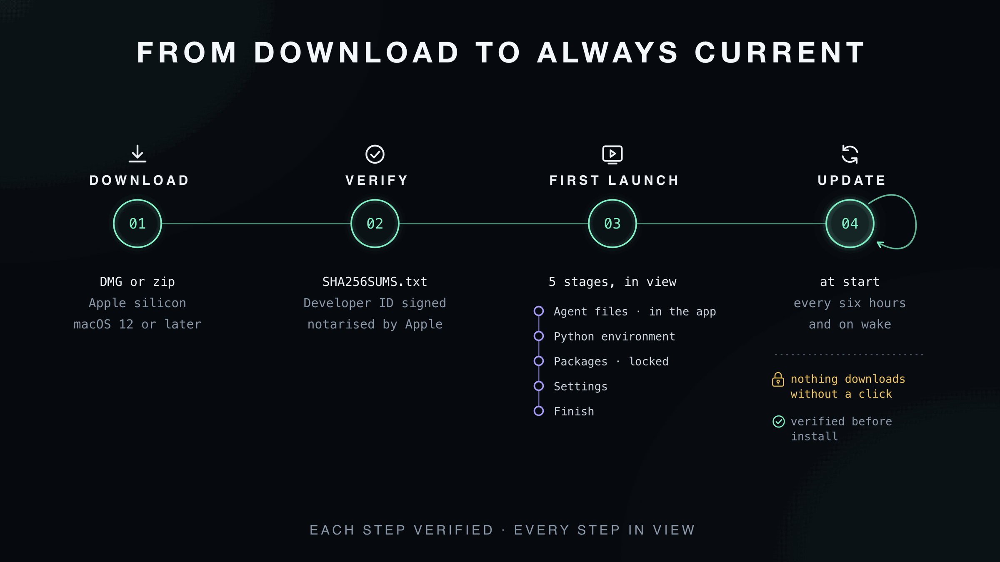

# How iclone os works

What runs on your Mac, what the agent may do, and how releases reach you.

## On your Mac

**On your Mac.** The app is an Electron shell around the Hermes agent runtime, which it installs on first launch
from a copy inside the app, checked against a pinned SHA-256. The runtime calls the model you choose: a provider
account, an API key, or a local endpoint. Every tool call passes the permission gate before it runs, and agent
commands are confined by default in a macOS Seatbelt sandbox.

## Your model

When you connect a provider, your messages, files, persona, memory and tool results — including screen captures, if you allow them — go
directly from your Mac to that provider, under its terms. A local endpoint (Ollama, llama.cpp, vLLM) keeps them on your machine. More in
[`docs/PRIVACY.md`](docs/PRIVACY.md).

## Permissions

**Permissions.** A short list of actions is refused in every mode. Everything else meets your privacy switches,
the level you set for that kind of action (e-mail, payments, shell, files and more) and the mode. When the answer
is *ask*, a sheet shows the exact action and the agent's reason. No answer in two minutes counts as Deny.

## Agent commands

**Sandbox.** Agent commands, tools, the browser and the helper programs they start run inside a macOS Seatbelt
profile that refuses anything it does not name. Confinement is on by default and stays on in every permission mode,
Ignore permissions included. The agent runtime process itself is not kernel-sandboxed; a guard refuses any program it
would start outside the sandbox. The **Containers** window shows every refusal and stops a process with everything it
started.

## The iNFT

**The iNFT.** You sign in with your wallet. The app reads the iNFTs that wallet holds and plays each token's
on-chain 3D model on the stage. The token stays in your wallet; your agent's memory, skills and history stay on
your Mac. No mode lets the agent transfer an iNFT.

## Install and update

**Install and update.** Releases are signed and notarised, and their hashes are listed in `SHA256SUMS.txt`. First
launch installs the agent runtime step by step, in view. The app checks for updates at start, every six hours and
when your Mac wakes, and downloads one only when you click.

## Trust model

The trust model, scope and how to report are in [`SECURITY.md`](SECURITY.md#trust-model-in-brief).
