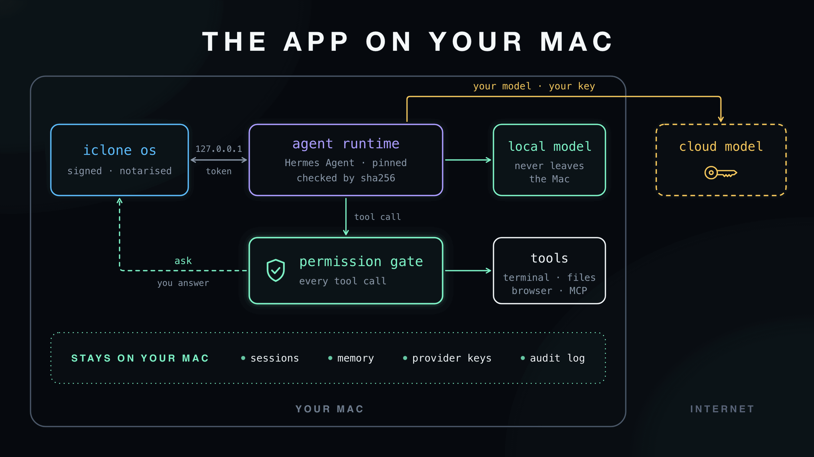
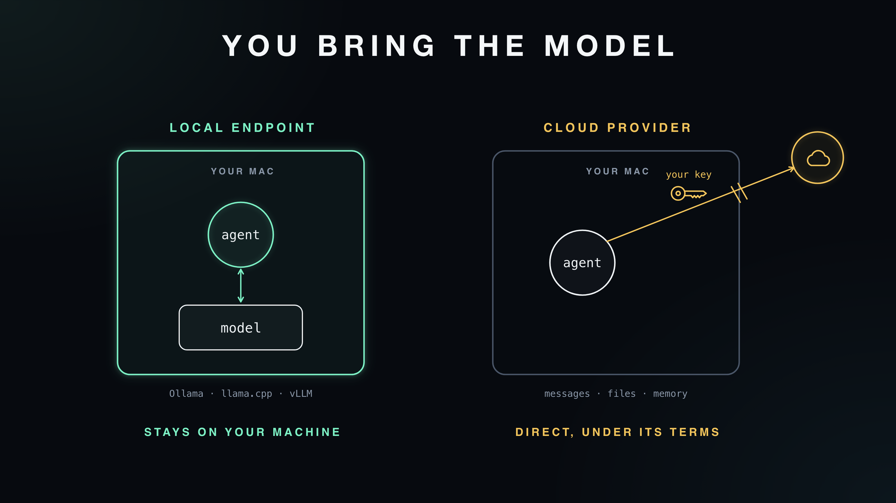
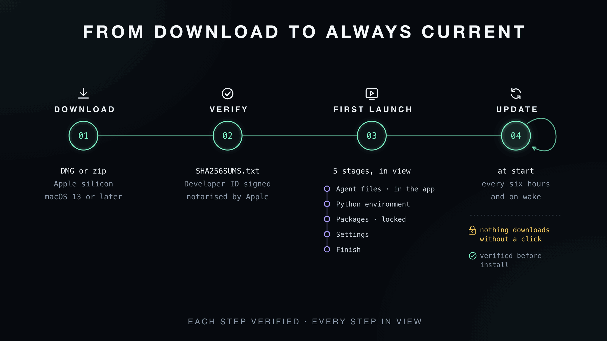

# How iclone os works

What runs on your Mac, what the agent may do, and how releases reach you.

## On your Mac

**On your Mac.** The app is an Electron shell around the Hermes agent runtime, which it installs on first launch
from a copy inside the app, checked against a pinned SHA-256. The runtime calls the model you choose: a provider
account, an API key, or a local endpoint. Every tool call passes the permission gate before it runs, and agent
commands are confined by default in a macOS Seatbelt sandbox, which you can turn off.

## Your model

When you connect a provider, your messages, files, persona, memory and tool results — including screen captures, if you allow them — go
directly from your Mac to that provider, under its terms. A local endpoint (Ollama, llama.cpp, vLLM) keeps them on your machine. More in
[`docs/PRIVACY.md`](docs/PRIVACY.md).

## Permissions

**Permissions.** A short list of actions, total destruction of the machine first, is refused in every mode. Everything else meets your privacy switches,
the level you set for that kind of action (e-mail, payments, shell, files and more) and the mode. When the answer
is *ask*, a sheet shows the exact action and the agent's reason. No answer in two minutes counts as Deny.

## Agent commands

**Sandbox.** Agent commands and the programs they start run inside a macOS Seatbelt profile that refuses anything it
does not name. Confinement is on by default, in every permission mode, and you can turn it off. A shell command you
approve runs once outside it, the agent's browser runs outside it through a door in the launcher, and the file tools
can go outside it for a single file in your home folder that no folder grant can open: once on the ask in the modes
that ask, with no ask in Ignore permissions. The agent runtime process itself is not kernel-sandboxed;
while confinement is on, a guard refuses any other program it would start outside the sandbox, except a shell command
you approve and the helpers the app runs for computer use and screen recording. The **Containers** window shows every refusal and stops a process with everything it
started.

## The iNFT

**The iNFT.** You sign in with your wallet. The app reads the iNFTs that wallet holds and plays each token's
on-chain 3D model on the stage. The token stays in your wallet; your agent's memory, skills and history stay on
your Mac. Outside Ignore permissions, moving an iNFT asks first; in Ignore permissions nothing asks.

## Install and update

**Install and update.** Releases are signed and notarised, and their hashes are listed in `SHA256SUMS.txt`. First
launch installs the agent runtime step by step, in view. The app checks for updates at start, every six hours and
when your Mac wakes, and downloads one only when you click.

## Trust model

The trust model, scope and how to report are in [`SECURITY.md`](SECURITY.md#trust-model-in-brief).
