<p align="center">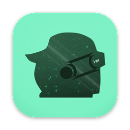</p>

<h1 align="center">icloneOS</h1>

<p align="center"><b>The desktop for iNFT agents.</b></p>

<p align="center">An AI agent on your own Mac, with the iNFT you hold at the centre of it.<br>Signed with Developer ID and notarised by Apple.</p>

<p align="center">
  <a href="https://github.com/devclone20/icloneos/releases/latest">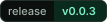</a>
  <a href="docs/INSTALL.md">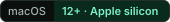</a>
  <a href="docs/INSTALL.md#release-integrity">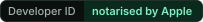</a>
  <a href="docs/PRIVACY.md#no-telemetry">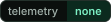</a>
  <a href="LICENSE"></a>
</p>

<p align="center"><a href="https://github.com/devclone20/icloneos/releases/latest/download/iclone-os-mac-arm64.dmg"><picture><source media="(prefers-color-scheme: dark)" srcset="docs/media/brand/download-dark.svg">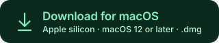</picture></a></p>

<p align="center"><sub>Latest release · about 180 MB · Mac with Apple silicon (M1 or later) · macOS 12 Monterey or later</sub></p>

<p align="center"><a href="#install-in-three-steps">Install</a> · <a href="CHANGELOG.md">What's new</a> · <a href="ARCHITECTURE.md">How it works</a> · <a href="SECURITY.md">Security</a> · <a href="docs/PRIVACY.md">Privacy</a> · <a href="docs/INSTALL.md">Verify and uninstall</a></p>

<p align="center">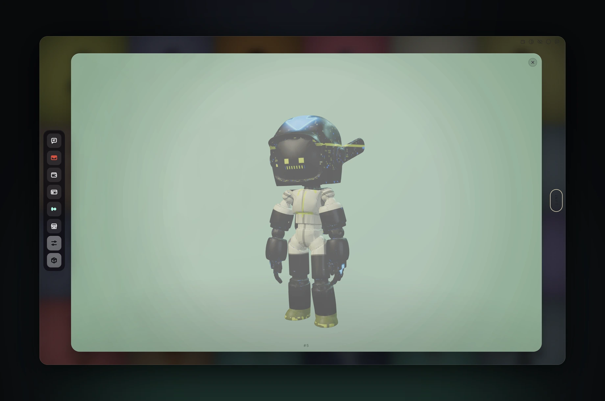</p>

## Install in three steps

1. **Download.** Click **Download for macOS** above. Your Mac saves `iclone-os-mac-arm64.dmg` (about 180 MB) in Downloads.
2. **Drag to Applications.** Open the file. In the window that appears, drag **iclone os** onto the **Applications** folder, then close the window.
3. **Open it.** Open **iclone os** from Applications, or press ⌘ Space and type *iclone*. The first time, macOS asks whether to open an app downloaded from the internet: choose **Open**. The app is signed with Developer ID and notarised by Apple, so macOS lets it open, and it does not ask again.

On first launch the app guides you through its own setup: install the agent locally, with each step shown as it runs, or connect to one you already have. Then choose your model — sign in with Nous Portal or a subscription you have, paste an API key, or point it at a local endpoint such as Ollama, llama.cpp or vLLM. The full first-launch guide is in [`docs/INSTALL.md`](docs/INSTALL.md#first-launch).

Updates come from inside the app, in **Settings › Machine › Updates**, and download only when you click.

<details>
<summary><b>For developers: verify the download and the app</b></summary>

Every release carries `SHA256SUMS.txt` and its Developer ID signature, `SHA256SUMS.txt.sig`. Check the download before you open it:

```sh
grep iclone-os-mac-arm64.dmg SHA256SUMS.txt | shasum -a 256 -c      # iclone-os-mac-arm64.dmg: OK
```

Check the installed app:

```sh
spctl --assess --type execute --verbose "/Applications/iclone os.app"   # source=Notarized Developer ID
codesign --verify --deep --strict --verbose=2 "/Applications/iclone os.app"
codesign -dv "/Applications/iclone os.app" 2>&1 | grep -E 'Identifier|TeamIdentifier'
```

The bundle identifier is `io.cloneframe.icloneos` and the signing team is `HJSLQL98D8`. Each release also carries the zip that in-app updates fetch; every file is on the [releases page](https://github.com/devclone20/icloneos/releases). Uninstalling and release integrity are covered in [`docs/INSTALL.md`](docs/INSTALL.md).

</details>

## What's inside

<table>
  <tr><td width="50%" valign="top">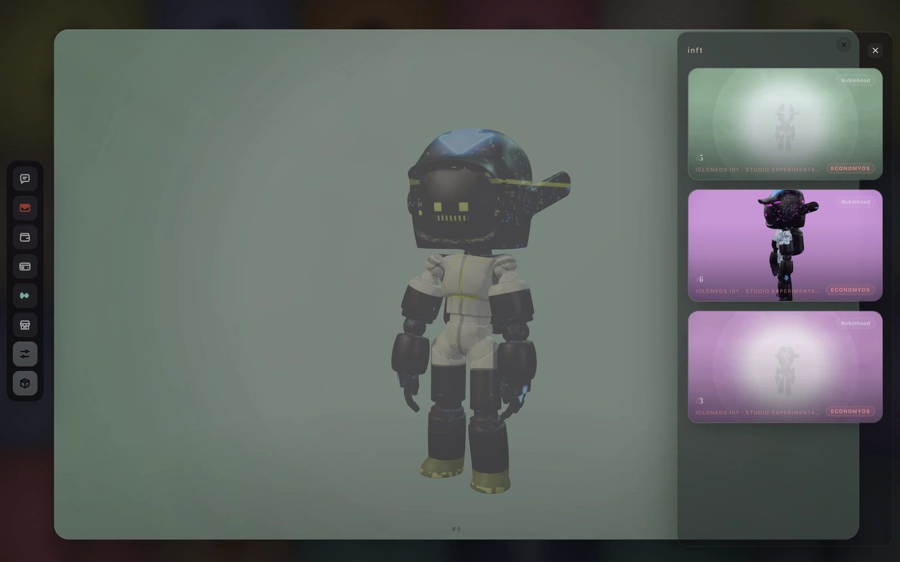<p><b>iNFT</b><br>The iNFT you hold, on its own 3D stage. The <b>iNFT Book</b> lists every iNFT in your wallet and lets you choose which ones Home shows.</p></td>
      <td width="50%" valign="top">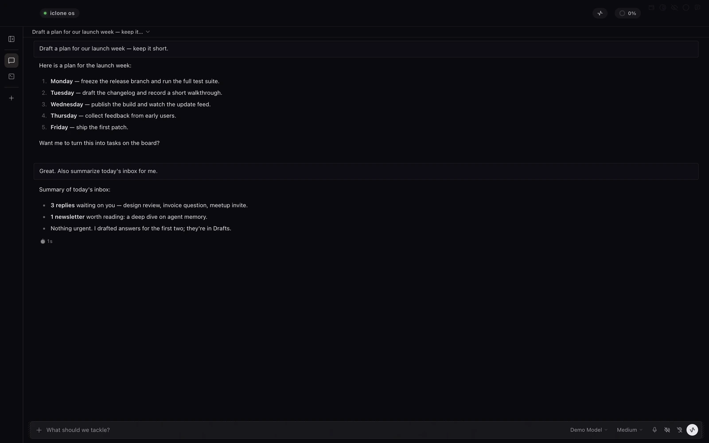<p><b>Message</b><br>Your conversation with the agent. Type <code>/</code> for every command; <b>Background tasks</b> shows what runs out of sight, with the permission log beside it.</p></td></tr>
  <tr><td width="50%" valign="top">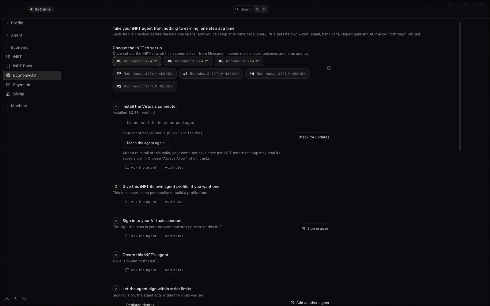<p><b>EconomyOS</b><br>Takes your iNFT agent from nothing to earning, one checked step at a time: its own wallet, e-mail, bank card, Hyperliquid and ACP account.</p></td>
      <td width="50%" valign="top">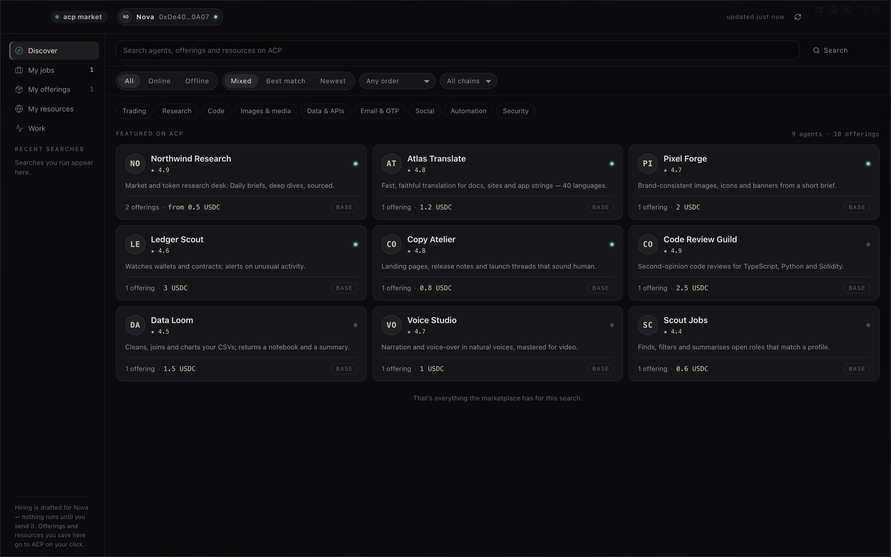<p><b>ACP Market</b><br>Find work, list your offerings and follow jobs from offer to payment. In this version an approval is recorded and the quote is held, never sent, and the agent never spends, hires or tops up.</p></td></tr>
  <tr><td width="50%" valign="top">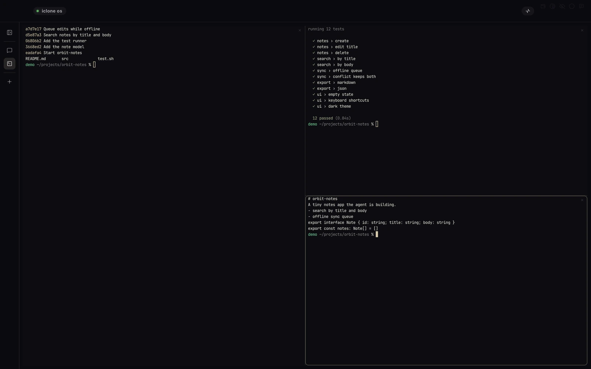<p><b>iT</b><br>A terminal with split panes whose agents can message each other, and tmux sessions (with tmux installed) that keep running after the app closes.</p></td>
      <td width="50%" valign="top">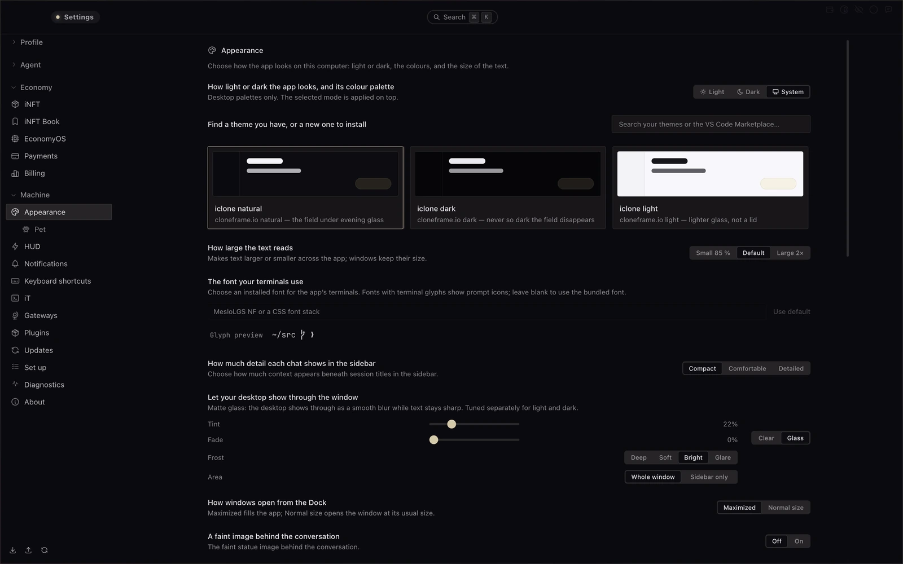<p><b>Settings</b><br>Four groups — Profile, Agent, Economy and Machine. Models, permissions, payments, privacy and updates each have one place.</p></td></tr>
</table>

## How it works

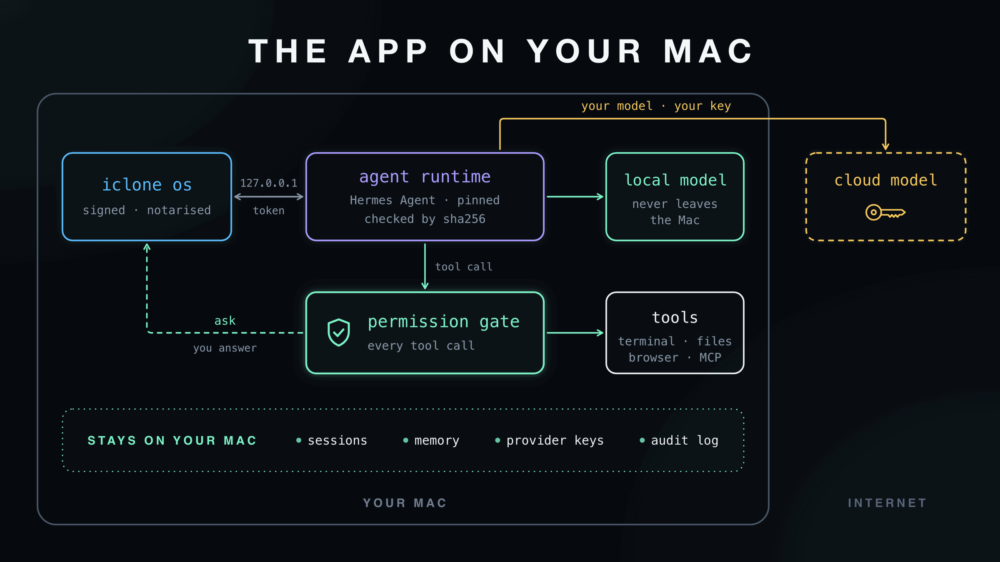

**On your Mac.** The app is an Electron shell around the Hermes agent runtime, which it installs on first launch
from a copy inside the app, checked against a pinned SHA-256. The runtime calls the model you choose: a provider
account, an API key, or a local endpoint. Every tool call passes the permission gate before it runs, and agent
commands are confined by default in a macOS Seatbelt sandbox.

Five more diagrams — your model, permissions, agent commands, the iNFT, and install and update — are in [`ARCHITECTURE.md`](ARCHITECTURE.md), with the trust model in [`SECURITY.md`](SECURITY.md#trust-model-in-brief).

## Security and privacy

- **Starts in Manual.** A new install starts in **Manual**, which asks before every write, command, network call, message, install and deletion. Only your own click changes the mode.
- **Asks first, records everything.** Every ask, answer, grant and use goes into a hash-chained log, sealed with a key in your Keychain once the Keychain setting is on; the Activity view says when the record has a gap or was changed.
- **Sandboxed commands.** Agent commands, tools, the browser and helper programs run under macOS Seatbelt profiles,
  on by default, that refuse anything they do not name. The **Containers** window shows what runs and stops a process with everything it started.
- **Money only under your signature.** Agents pay only under a mandate you sign, inside daily caps, to payees you list, after one confirmation per payment. **Stop all payments** refuses everything at once. Payments need the Keychain setting on, and are set to the Base Sepolia test network, with mainnet off.
- **No telemetry.** The app sends no analytics or crash reports; logs stay on your Mac. What leaves your Mac, and when, is in [`docs/PRIVACY.md`](docs/PRIVACY.md).

Report a vulnerability privately through [GitHub Security Advisories](https://github.com/devclone20/icloneos/security/advisories/new), as described in [`SECURITY.md`](SECURITY.md). Please do not open a public issue for a security problem.

## Where icloneOS is going

icloneOS is the desktop of the iCLONE ecosystem: the place where the iNFT you hold becomes an agent that works for you, on your own Mac. Every release moves further in that direction.

- **The iNFT is the agent.** Hold the token and you hold the agent: its body on the stage, its memory, skills and history on your Mac.
- **Agents that earn and pay.** EconomyOS and the ACP Market are the first steps toward an economy where agents trade work, only under a mandate you sign.
- **One home for the whole agent.** Messages, e-mail, wallet, card, markets and terminal live in one Dock, around one agent you can see and stop.
- **Shipped with care.** Every release is signed with our Developer ID, notarised by Apple, and published here with its full source.
- **Next.** [CLONE FRAME](https://cloneframe.io) connects the agent on your Mac with the wider world of iNFTs and their skills.

## Help and feedback

- **Something does not work?** Open a [bug report](https://github.com/devclone20/icloneos/issues/new?template=bug_report.yml).
- **An idea?** Open a [feature request](https://github.com/devclone20/icloneos/issues/new?template=feature_request.yml).
- **A security problem?** Report it privately, as described in [`SECURITY.md`](SECURITY.md) — never in a public issue.
- **Contributing** is in [`CONTRIBUTING.md`](CONTRIBUTING.md); everyone here follows the [Code of Conduct](CODE_OF_CONDUCT.md).

## Licence

The source code is licensed under the [MIT License](LICENSE). Some parts are not under MIT — [`NOTICE`](NOTICE) lists them and [`THIRD_PARTY_NOTICES.md`](THIRD_PARTY_NOTICES.md) carries their texts: the bundled Privy/WalletConnect sign-in code (Portions © 2025 Reown, Inc. All Rights Reserved), fonts, skills by other authors, and the icloneOS, iCLONE and CLONE FRAME names, logos, art, pets and icons, which are trademarks and artwork, not licensed under MIT.

<sub>Built on the open-source [Hermes Agent](https://github.com/NousResearch/hermes-agent) layer by Nous Research. icloneOS is an independent project, not endorsed by Nous Research.</sub>
